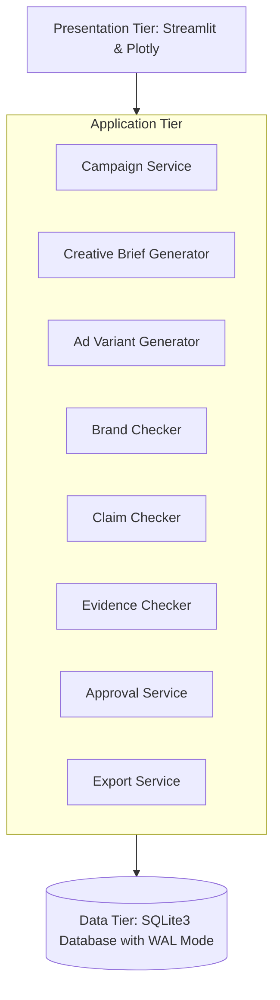
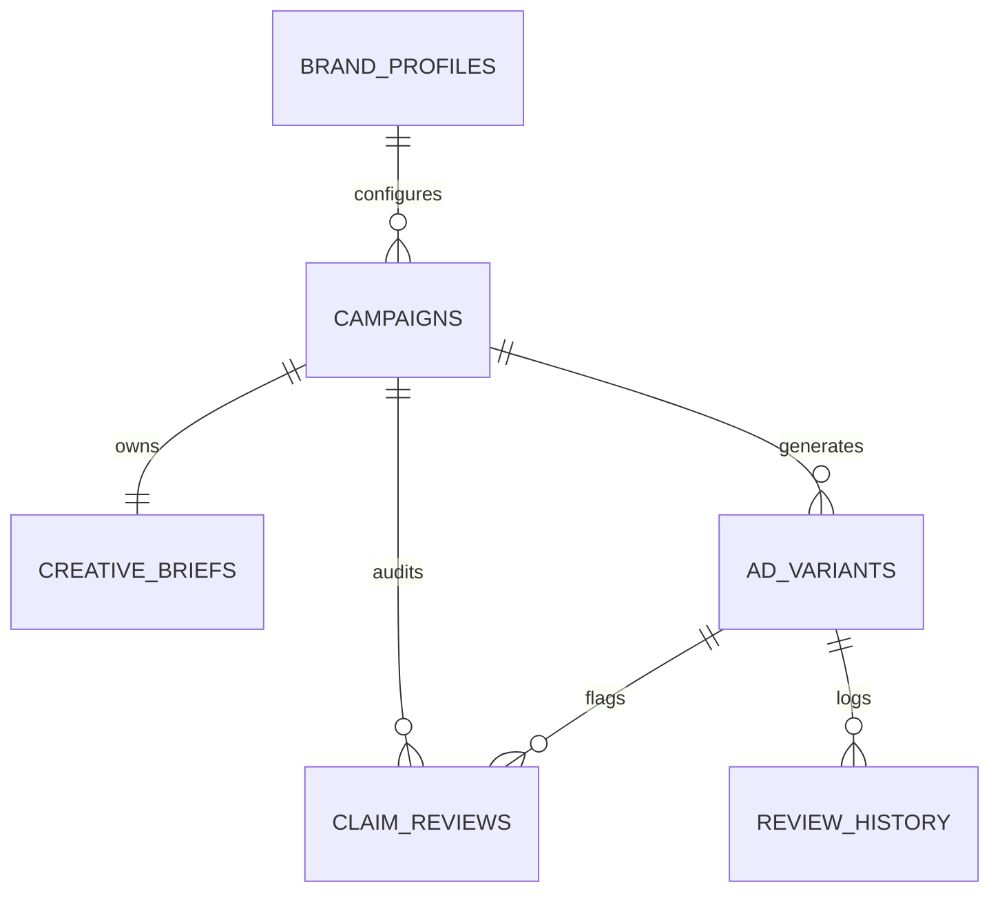

# Project Overview: Marketing Creative Brief & Ad Variant Generator

**Academic Program:** Master of Science in Information Technology (M.Sc. IT)  
**Project Title:** Marketing Creative Brief & Ad Variant Generator  
**Architecture Classification:** Modular 3-Tier Layered Architecture with Local SQLite Persistence  

---

## 1. Executive Summary & Problem Formulation

In modern performance marketing, creating high-converting creative briefs and ad copy variants requires synthesizing complex product specifications, target audience psychology, campaign objectives, and strict legal/brand constraints.

Traditional approaches suffer from two failure modes:
1. **Manual Friction:** Copywriters often skip systematic creative brief drafting, leading to inconsistent brand messaging, misaligned calls to action (CTAs), and uncoordinated channel assets.
2. **Generative Hallucination in Unbounded LLMs:** Off-the-shelf generative AI models regularly hallucinate product features, invent promotional discount terms, make unauthorized performance guarantees (e.g. "guaranteed 10x ROI"), or fabricate testimonials—exposing businesses to severe regulatory penalties under consumer protection laws (e.g. FTC guidelines, ASA regulations).

### The Proposed Solution
The **Marketing Creative Brief & Ad Variant Generator** introduces a deterministic, rule-based marketing platform that bridges structured input capture with channel-tailored ad copy generation. It enforces a strict "Truth-in-Advertising" architectural boundary: **product facts are never invented, claims requiring evidence are flagged with severity tiers, and no advertisement can be published without human review and approval.**

---

## 2. System Architecture

The project adheres to a basic-to-intermediate, clean 3-tier architecture:

### Architectural Principles
1. **Separation of Concerns:** Copy generation, claim checking, brand rule enforcement, and approval state management are partitioned into isolated service modules.
2. **Local Persistence:** Uses Python's standard `sqlite3` engine with WAL (Write-Ahead Logging) and enforced foreign key constraints (`PRAGMA foreign_keys = ON;`).
3. **Deterministic grounded generation:** Templates and parametric slot fillers ensure that generated copy strictly derives from the supplied product description and benefits without fabricating statistics.
4. **Human-in-the-Loop (HITL) Gate:** Automated heuristics flag potential violations, but final approval is reserved exclusively for a human reviewer.

---

## 3. Database Schema & Data Dictionary

The persistence model comprises six normalized relational tables:

### Table Definitions

| Table Name | Primary Key | Key Foreign Keys | Purpose |
|---|---|---|---|
| `campaigns` | `id` (TEXT) | `brand_profile_id` ➔ `brand_profiles(id)` | Stores core product, audience, objective, offer, and brand rules. |
| `brand_profiles` | `id` (TEXT) | None | Stores reusable brand guidelines (tone, allowed/prohibited terms, disclaimers). |
| `creative_briefs` | `id` (TEXT) | `campaign_id` ➔ `campaigns(id)` | Stores synthesized brief sections, distinguishing verified facts from suggestions. |
| `ad_variants` | `id` (TEXT) | `campaign_id` ➔ `campaigns(id)` | Stores generated ad variants (angle, hook, headline, body, CTA, review status). |
| `claim_reviews` | `id` (TEXT) | `campaign_id`, `variant_id` | Audit table tracking individual claim warnings, required evidence, and decisions. |
| `review_history` | `id` (TEXT) | `variant_id` ➔ `ad_variants(id)` | Immutable audit trail of reviewer actions, timestamps, and justification notes. |

---

## 4. Copy Generation & Advertising Angle Engine

The generation engine tailors messaging across 11 marketing angles and 7 channel-optimized hook formulas:

### 11 Supported Marketing Angles
1. **Problem & Solution:** Frames audience pain point and introduces the product as direct relief.
2. **Benefit-Focused:** Spotlights primary transformational customer value over technical details.
3. **Product Feature Deep-Dive:** Focuses on functional capabilities and utility.
4. **Convenience & Simplicity:** Emphasizes time saved, simplified workflows, and ease of adoption.
5. **Educational & Informative:** Shares domain knowledge, positioning the brand as a credible advisor.
6. **Value for Money & ROI:** Highlights cost efficiency, measurable ROI, and waste elimination.
7. **Comparison & Superiority:** Contrasts against alternatives (gated: strictly requires verified proof).
8. **Emotional Resonance & Peace of Mind:** Addresses user confidence, reducing stress and anxiety.
9. **Use-Case & Scenario:** Paints a concrete real-world situation where the product shines.
10. **Unique Differentiation:** Articulates distinct competitive market position.
11. **Direct Offer & Incentive:** Highlights promotional discount terms and trial conditions.

### Channel-Specific Copy Structures
- **Social Media:** Visual hook, concise problem context, bulleted feature proofs, and direct CTA.
- **Search Advertising:** High-intent Headline 1 \| Headline 2 structure with character limits, benefit summary, and explicit action CTA.
- **Email Marketing:** Engaging subject line, preview pre-header, personal salutation, context narrative, bulleted benefits, and button CTA.
- **Display Advertising:** Compact, high-impact headline (<45 chars), succinct subhead, and clear button CTA.

---

## 5. Compliance, Claim Detection & Governance Model

The platform incorporates automated pattern-matching heuristics to safeguard regulatory and brand integrity:

### Claim Detection Rules
- **Numerical Performance Claims:** Scans for percentage improvements, multiplier claims (e.g. `3x faster`), monetary savings (`$10,000`), or SLA guarantees (`99.9% uptime`).
- **Absolute Superlatives:** Identifies unverified claims such as `the best`, `world's #1`, `safest`, `unrivaled`, or `the only solution`.
- **Guarantees:** Detects representations like `100% guaranteed`, `risk-free`, or `money-back guarantee`.
- **Sensitive Health & Financial Claims:** Flags medical treatment claims (`cures`, `fda approved`, `lose 20 lbs`) or financial promises (`guaranteed returns`, `passive income`).
- **Promotional Terms:** Detects discounts (`50% off`) lacking published terms, expiry dates, or purchase conditions.

### Severity Tiers & Approval Gating
1. **Low Severity:** Corroborated claims or minor punctuation/stylistic suggestions.
2. **Medium Severity:** Unverified numerical claims or minor tone inconsistencies.
3. **High Severity:** Unverified medical/financial claims, prohibited brand terminology, missing mandatory disclaimers, or unbacked performance guarantees.

**Governing Policy:** The system enforces an architectural block preventing variants with unresolved High-severity warnings from being approved unless an authorized reviewer enters an explicit override justification and cites formal evidence references.

---

## 6. Extensibility for Future LLM Integration

The application architecture isolates generation logic behind `AdVariantGenerator` and `CreativeBriefGenerator`. In future iterations, local small-language models (SLMs) such as Google Gemma 2 or Ollama-based Llama models can be plugged in by swapping the template renderer with an LLM prompt pipeline while preserving the exact same database schema, claim audit verification, and human review governance layer.
